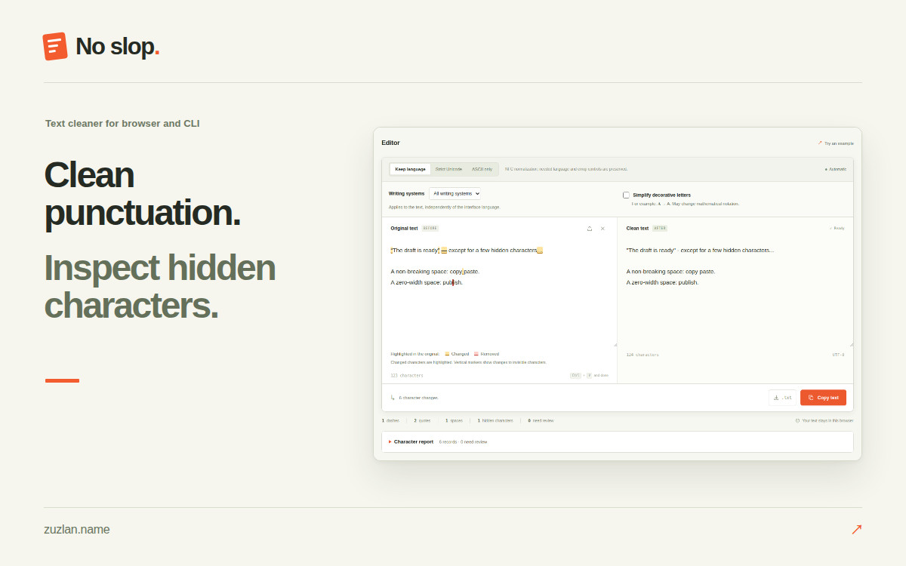
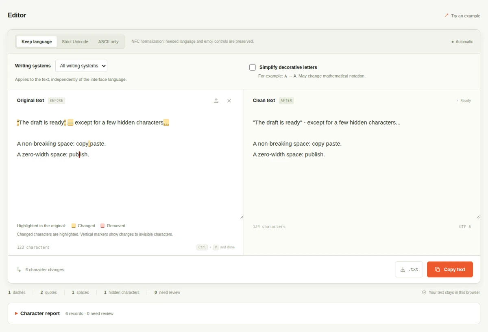

# No slop (Bez Slopu)

Clean punctuation, remove unnecessary invisible characters, and inspect Unicode in your browser or terminal.

**[Try it in your browser](https://www.zuzlan.name/ai-anti-detect/?lang=en)** | **[Download the CLI](https://www.zuzlan.name/ai-anti-detect/downloads/bez-slopu.mjs)** | [User guide](USER_GUIDE.md)

No slop applies fixed character rules locally. It replaces long dashes and smart quotes with plain punctuation, normalizes spaces and Unicode, and reports characters that need a closer look. Your sentences and paragraphs stay in place.

## When it helps

- **Before publishing:** clean punctuation and unusual spaces in a post, article, or product description.
- **After copying text:** inspect hidden characters and letters from different writing systems that look alike.
- **In a script or agent workflow:** process a UTF-8 file or stdin and read a JSON report. Strict mode blocks export when findings still need review.



## Start in the browser

1. [Open the editor](https://www.zuzlan.name/ai-anti-detect/?lang=en) and paste text or open a UTF-8 file.
2. Keep the default **Keep language** mode, or choose **Strict Unicode** to block export on unresolved findings.
3. Compare the original and result, check the character report, then copy or download the text.

Processing runs in your browser without uploading the text. The interface is available in ten languages; its language setting is separate from the text's writing systems.

## Start with the CLI

Download `bez-slopu.mjs` using the link above. You need **Node.js 22 or later**. No package installation or API key is required.

```sh
node bez-slopu.mjs draft.txt -o clean.txt
node bez-slopu.mjs --strict --json < draft.txt
node bez-slopu.mjs --help
```

The CLI works offline. For automated use, accept `text` only after a successful strict run with `blocked: false`, no unresolved reviews, and checked warnings.

## Choose the right mode

| Mode | Behavior |
| --- | --- |
| Keep language / `text` | Preserves Unicode letters, cleans characters, and reports findings. |
| Strict Unicode / `strict` | Uses the same rules and blocks export while findings need review. |
| ASCII only / `ascii` | Audits the original, then transliterates or replaces unsupported characters with `?`. Review conversion losses. |

The tool is intended for prose. It does not rewrite sentences, determine authorship, or guarantee AI-detector results. Unicode checks use character rules and context; some cases need a human decision. Keep language or Strict Unicode is the appropriate choice when you need to preserve multilingual text.

## Help

See the [user guide](USER_GUIDE.md) for reports, CLI exit codes, and limits, or read the [browser FAQ](https://www.zuzlan.name/ai-anti-detect/?lang=en#faq). Visit the [author's website](https://www.zuzlan.name) for contact information.

This repository contains product documentation and visuals. Use the links above to run the browser tool or download the standalone CLI.
